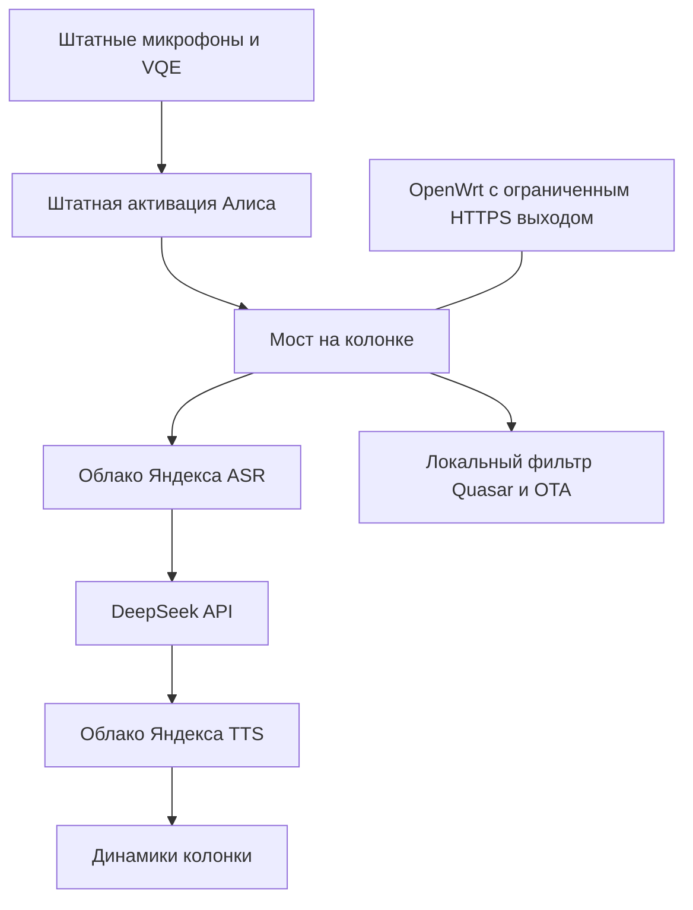

# Техническая запись эксперимента со Станцией Миди

Эта версия сохраняет подробное описание рабочего эксперимента. В ней встречаются команды, пути и ссылки на подготовленные тогда скрипты. Программные файлы к этой публикации не прилагаются; это запись устройства и проверок системы, а не готовый установочный комплект.

# Гибрид Яндекса и DeepSeek на Яндекс Станции Миди

Руководство по конфигурации, проверенной 26 октября 2026 года на **YNDX-00054 / cucumber**: колонка принимает голос штатными микрофонами, Яндекс распознаёт речь, DeepSeek формирует ответ, Яндекс озвучивает его голосом Алисы. Мост работает на самой колонке; постоянно включённый ПК не нужен. Для сетевого ограничения нужен работающий OpenWrt.

Это инженерная инструкция для владельца собственного устройства. Подтверждена одна аппаратная модель с одной реально запущенной заводской прошивкой. Многонедельный ресурсный тест не проводился. Универсальный установщик и гарантированный аппаратный способ восстановления не предлагаются.

## Что получилось

| Возможность | Подтверждённый результат |
| --- | --- |
| Root | Сетевой ADB от UID 0, сохраняется после перезагрузки |
| Голос | Штатная активация и обработка микрофонов → Яндекс ASR → DeepSeek → Яндекс TTS |
| Работа без ПК | Проверена после перезагрузки колонки при остановленных службах ПК |
| Память | Около 132 МиБ RSS у моста после запроса; измерение одного устройства |
| Место | Около 332 МиБ в `/data`, включая Python и зависимости |
| Автозапуск | Init-скрипт перед штатным Quasar и watchdog |
| OTA | Обновлятор отключён; сетевой выход ограничен; предложения и файлы обновлений фильтруются |
| Возврат | Остановка локального моста и возврат маршрута на ПК испытаны |
| Музыка и умный дом | В этой конфигурации не реализованы |

Распознавание и озвучка облачные. Интернет необходим, а использование DeepSeek требует собственного API-ключа и доступного баланса. Отдельный интернет-поиск в ответы не подключён.

## Сначала проверьте совместимость

| Сборка | Что проверено |
| --- | --- |
| `0.9.1.14.2629069308.20241018.factory-9` | Реальный root, весь гибрид, автозапуск и перезагрузка на Миди |
| `0.369.1.46.4778262955.20261013.160` | Только статический анализ образа; установка и root на ней не проверены |
| `0.369.1.50.4794663100.20261021.160` | Только статический анализ; используемая цепочка TLS не прошла проверку с CA из этого образа |
| Другие сборки и модели | Совместимость не установлена |

В описанном случае после ранее выполненного владельцем сброса фактически загрузилась заводская система 2024 года. Это **не означает**, что любой заводской сброс любой Миди откатывает прошивку. Сброс нельзя использовать как гарантированный метод даунгрейда.

После получения доступа смотрите реальную версию:

```sh
cat /system/vendor/quasar/version_full
id
uname -a
```

Динамические ARM64-библиотеки этого пакета проверены на заводском userspace AArch64 / glibc 2.30. У исследованной retail `.46` userspace — ARM 32 bit, несмотря на 64-битное ядро. Одного `uname -m` для выбора бинарников недостаточно.

## Как устроена система



Мост принимает настоящую сессию колонки. В облако идут отдельные `AsrRecognize` и `TtsGenerate`, а обычные `VoiceInput` и `TextInput` для запуска штатного понимания команд не отправляются. Так не возникает второй ответ обычной Алисы. Штатные обработчики активации и микрофонов остаются на устройстве. Слышимость поверх громкой музыки отдельно не проверялась: сама музыка в этом маршруте не реализована.

На колонке выполняются небольшая модель Silero VAD, преобразование Opus и сетевой код. GigaAM, PyTorch, CUDA и локальная большая языковая модель для конечной конфигурации не нужны.

## Порядок воспроизведения

1. Определить версию, получить root и сделать резервные копии. До изменения системных файлов нужно проверить рабочий доступ и сохранить оригиналы.
2. Подготовить изоляцию и маршрут через ПК. Прямой выход колонки не открывается ради первоначальной настройки.
3. Проверить гибрид на ПК на основе фиксированного upstream и приложенного патча.
4. Собрать ARM64-окружение и установить его в `/data`. Сначала запуск вручную, затем проверка сетевых ограничений.
5. Включить автозапуск, переключить DNS на саму колонку, остановить службы ПК и проверить перезагрузку и голос.
6. Проверить возврат и сохранить инструкции обслуживания.

Не переходите к следующему этапу, если предыдущая проверка не прошла. Подготовленные скрипты **не подключаются автоматически к роутерам и не записывают образы разделов**. Сборщик работает на ПК с файлами; аппаратные изменения выполняются отдельными явными командами владельца.

## Что находится в пакете

| Путь | Назначение |
| --- | --- |
| `docs/` | Пошаговые инструкции, проверка совместимости, откат и разбор ошибок |
| `examples/settings.example.json` | Пример адресов; MAC и DID нужно указать свои |
| `scripts/render_config.py` | Создание настроек и скриптов под вашу сеть |
| `scripts/build_release.py` | Получение фиксированного upstream, применение патча, сборка архива |
| `scripts/set_api_key.py` | Скрытый ввод ключа и передача через ADB sync без ключа в командной строке |
| `scripts/prepare_persistence.py` | Подготовка правок ADB/OTA из оригиналов именно вашей колонки с проверкой хэшей |
| `patches/quasard-hybrid.patch` | Изменения к фиксированному коммиту quasard |
| `templates/` | Отдельный облачный клиент и шаблоны служб, фильтра и диагностики |
| `requirements-arm64.lock` | Версии зависимостей реально проверенного ARM64-окружения |
| `runtime-source.json` | Ссылка и SHA256 проверенного Python |
| `evidence/tested-case.json` | Обезличенный перечень проверок и границ доказанного |

Исходный quasard скачивается отдельно с фиксированного коммита. Образы прошивок, резервные копии, сертификаты, закрытые ключи и записи владельца в пакет не входят. Генерируемые `settings.json`, `rendered/`, `build/`, `certs/` и `private/` предназначены только для локального использования.

## Защита обновлений и отключение света

Защита состоит из независимых уровней: отключённая задача `updatesd`, заглушка штатного установщика, ограничение прямого интернета на основном роутере, карантин и разрешённый список направлений OpenWrt, локальный фильтр ответов Quasar.

Если колонка стартует раньше роутеров или фильтра, облачные функции временно не работают. Отключение обновлятора не нужно применять заново: правки находятся в системных файлах. `S96` запускается перед `S97`, но в фоне — полная готовность моста раньше штатного Quasar не гарантируется и не является единственной защитой.

Автозапуск после перезагрузки колонки проверен. Настройки OpenWrt сохранены, службы включены в загрузку. Одновременное физическое выключение обоих роутеров и колонки **не испытывалось**; автоматическое восстановление в таком сценарии ожидается по настройкам, но отдельным испытанием не подтверждено.

## Что этот результат не подтверждает

Root не доказывает разблокировку загрузчика, возможность загрузить собственную ОС или записать произвольную модифицированную OTA. Пересчёт SHA256 не создаёт подпись производителя. Наличие резервных образов не гарантирует восстановление устройства, которое больше не загружается.

Работа гибрида не гарантирует правильности ответа языковой модели. В первом голосовом тесте 23 × 7 владелец сообщил «167» вместо 161; точная причина не установлена. В повторном тесте 7 + 8 получен и услышан правильный ответ 15. Ошибку нельзя выдавать за доказанный дефект только ASR или только DeepSeek.

Яндекс видит аудио распознавания, текст озвучки и сведения сессии; DeepSeek видит текст диалога. Незаметность, официальная поддержка внутреннего протокола и отсутствие будущих ограничений не установлены. Подробнее о приватности и источниках.

## Основа и проверенная версия

Основа — [quasard](https://github.com/amirilivice/quasard), коммит `a142b19c997f3a8a4bed8f6b0aef4acd70e2436e`. ARM64 Python — [python-build-standalone, выпуск 20261021](https://github.com/astral-sh/python-build-standalone/releases/tag/20261021). Использован DeepSeek API с моделью `deepseek-flash`; доступные модели и условия API следует сверять с [официальной документацией](https://api-docs.deepseek.com/).

Исследования root и сетевого обмена других авторов перечислены в разделе источников. Их поддержка других моделей не переносится автоматически на Миди. На проверенном коммите quasard отдельный файл LICENSE в корне не найден; этот пакет не объявляет единую лицензию на чужой код и его компоненты.


## Версия системы, root и резервные копии

### До подключения к интернету

Нужны собственная YNDX-00054, доступ к настройкам её Wi-Fi и OpenWrt, ПК для первоначальной подготовки, ADB и способность восстановить предыдущую сетевую конфигурацию. Не используйте MAC, DID, IP и ключи из чужих журналов.

Определите MAC Wi-Fi в таблице клиентов роутера. DID — идентификатор устройства, он не является MAC или IP. Закрепите адрес DHCP. В примерах используется сеть `192.168.50.0/24`: основной роутер `.1`, OpenWrt `.2`, колонка `.60`, временный ПК `.70`. Эти адреса выбраны для документации и не описывают сеть исходного владельца.

Сначала ограничьте прямой интернет колонки и проверьте запрет, затем разрешайте первоначальную настройку через контролируемый фильтр. Постоянно отключённый WAN мешает настройке; фильтрация позволяет пропускать нужные API, отклоняя предложения и скачивание OTA.

### Как в проверенном случае появился ADB

Использован совместимый с заводской системой HTTPS-прокси. В настоящем ответе `/get_sync_info` он сохранял остальные поля и добавлял настройки `adbd`: `remoteActivation=true`, `network=true`, `fullDurationMs=31536000000`; существующий `forceDisable` устанавливался в `false`. Это не универсальный эксплойт для любой прошивки.

Для такого маршрута необходимы совместимый сертификат и доверие к его цепочке со стороны конкретной прошивки. Использован опубликованный проектом lite-kit набор eQuasar; файлы сертификата и ключа сюда не включены. Розничная `.50` из нашего анализа не доверяла использованной цепочке. Если TLS отвергается, сначала проверяйте совместимость; наличие `adbd` в образе ничего не гарантирует.

Перенаправьте пять адресов Яндекса на временный ПК, запустите подготовленный фильтр и выполните настройку Wi-Fi штатным приложением. Не открывайте интернет целиком, если приложение показывает ошибку. В исходном случае карточка настройки в приложении могла оставаться с ошибкой, хотя голосовой обмен уже работал. Это не доказательство полной штатной совместимости.

Пример запуска фильтра после генерации настроек и помещения своих совместимых TLS-файлов в `rendered/station/certs/`:

```sh
python rendered/station/station_setup_proxy.py --enable-adb
```

На Windows ограничьте входящие TCP 80/443 адресом колонки; не открывайте эти порты в WAN. На Linux низкие порты требуют соответствующих прав. Убедитесь, что их не заняло другое приложение. Эта начальная команда включает только API-фильтр; голос пока пересылается в штатное облако.

ADB подключается отдельно, без SSH-логина:

```sh
adb -P 5038 connect 192.168.50.60:5555
adb -P 5038 -s 192.168.50.60:5555 shell
```

Внутри колонки:

```sh
id
cat /system/vendor/quasar/version_full
uname -a
cat /sys/class/net/wlan0/address
cat /proc/mounts
```

Для дальнейших скриптов требуется `uid=0` и точная версия `0.9.1.14.2629069308.20241018.factory-9`. Старый adbd может представляться как Nexus 4 / mako; сверяйте настоящее устройство по MAC и версии. Buildroot — Linux, обычные Android APK здесь не устанавливаются. SSH, YSE и Pulsar эта инструкция не устанавливает.

### Что сохранить

До записи системных файлов сохраните на ПК оригиналы `activate_adb.sh`, `launch.json`, `device_ota_update.sh`, конфигурацию роутеров и сведения о разметке накопителя. Пользовательские настройки могут содержать Wi-Fi и токены аккаунта: храните такие копии отдельно от публикуемого пакета.

Пример чтения оригинальных файлов:

```sh
adb -P 5038 -s 192.168.50.60:5555 pull /system/vendor/quasar/activate_adb.sh backup/native/activate_adb.sh
adb -P 5038 -s 192.168.50.60:5555 pull /system/vendor/quasar/launch.json backup/native/launch.json
adb -P 5038 -s 192.168.50.60:5555 pull /system/vendor/quasar/device_ota_update.sh backup/native/device_ota_update.sh
```

Каталог `backup/native` создайте заранее. Отдельно запишите размеры и SHA256 нужных разделов. В исходном случае сохранены шесть образов: bootloader, env, boot, recovery, system, aml_sysrecovery. Это не полный eMMC: RPMB, аппаратные секреты и всё содержимое пользовательского раздела в эти образы не входят. Нельзя переносить размеры и адреса разделов с другой модели. Команд записи сырых образов это руководство намеренно не содержит: проверенного аппаратного восстановления не было.

### Закрепление ADB и отключение штатной OTA

Подготовка из ваших собственных оригиналов:

```sh
python scripts/prepare_persistence.py --serial 192.168.50.60:5555 --adb-port 5038
```

Скрипт проверяет точную версию и SHA256 трёх исходных файлов. При несовпадении он прекращает работу. Не удаляйте проверки хэшей ради установки на другую систему.

Полученные файлы загрузите в путь, который ожидает проверенный установщик:

```sh
adb -P 5038 -s 192.168.50.60:5555 shell mkdir -p /data/local/tmp/codex-root-install-20261026
adb -P 5038 -s 192.168.50.60:5555 push build/persistence/. /data/local/tmp/codex-root-install-20261026/
adb -P 5038 -s 192.168.50.60:5555 shell sh /data/local/tmp/codex-root-install-20261026/install.sh
```

Меняются только три служебных файла. `activate_adb.sh` игнорирует деактивацию и вызывает сохранённый оригинал с сетевым режимом. Из `launch.json` удаляется только задача `--updatesd`. Установщик OTA заменяется заглушкой с `exit 1`. Оригиналы сохраняются рядом с суффиксом `.codex-original`; открытый ключ проверки OTA не заменяется.

Если возврат `/` в режим `ro` завершился `busy`, не применяйте принудительное размонтирование работающей системы. Сохраните вывод и убедитесь в целостности копий; в исходном случае проблема открытого заменённого файла разрешилась штатной перезагрузкой. Это не основание игнорировать прочие ошибки установки.

После обычной перезагрузки проверьте UID 0, MAC, режим `/` `ro`, отсутствие процесса `maind --updatesd`, наличие оригиналов и новых контрольных сумм. Первый тест сохранения root выполняйте при остановленном фильтре ПК: root не должен зависеть от повторного получения конфигурации из облака.


## Сетевой карантин, фильтр OTA и временный ПК

### Поддержанная топология

Основной роутер обслуживает Wi-Fi, DHCP и обычный шлюз. OpenWrt находится в той же LAN, имеет постоянный адрес и обслуживает частный DNS колонки и ограниченный HTTPS-выход. В проверенном случае основной роутер — TP-Link Archer AX12, OpenWrt — Orange Pi Zero 3. Мост находится на колонке, VPN-конфигурация роутера для него не заменяется.

Пример документации:

| Узел | Адрес |
| --- | --- |
| Основной Wi-Fi роутер | `192.168.50.1` |
| OpenWrt | `192.168.50.2` |
| Колонка с DHCP reservation | `192.168.50.60` |
| ПК только для установки и возврата | `192.168.50.70` |

OpenWrt в этой топологии не выдаёт колонке DHCP. Ранний карантин отбрасывает её DHCP-пакеты к OpenWrt; адрес выдаёт основной роутер. Для другой топологии правила нужно переработать. AP, который маршрутизирует или подменяет MAC до OpenWrt, тоже требует отдельной проверки счётчиков правил.

### Сначала собственные параметры

Скопируйте `examples/settings.example.json` в `settings.json`, задайте адреса, действительные Wi-Fi MAC и DID своей колонки. Ключ API в этот файл не помещается. Генерация работает только с локальными файлами:

```sh
python scripts/render_config.py settings.json
```

Просмотрите `rendered/router/` и `rendered/station/`. Не применяйте чужой MAC. Не меняйте режимы устройства по сходству серийного номера: сверяйте именно Wi-Fi MAC и DID.

### Ограничение на основном роутере

Закрепите IP колонки, сохраните отдельное ограничение её прямого доступа в интернет, укажите OpenWrt в обоих полях DNS DHCP. Изменение DNS DHCP может затронуть другие устройства; обычный DNS OpenWrt на порту 53 для них должен продолжить работать.

В проверенной конфигурации IPv6 на основном роутере отключён. При сохранении IPv6 нужна отдельная проверенная эквивалентная изоляция: ограничения только IPv4 недостаточно.

Для AX12 использовался профиль родительского контроля только для MAC колонки. Не считайте пустое расписание универсальным значением «запрещено»: интерфейсы и смысл расписаний у других роутеров отличаются. Проверяйте реальную попытку HTTP/HTTPS с колонки. SYN-ACK, открытие TCP и ответ HTTP CONNECT `200` ещё не доказывают доступ к внешнему содержимому.

### OpenWrt

Требуются `dnsmasq`, `nftables/fw4`, NTP-сервер для LAN и `sing-box`. Проверенная версия sing-box — **1.12.17**; схема конфигурации должна пройти `sing-box check`. Не устанавливайте пакет по названию менеджера из чужой инструкции: сборки OpenWrt различаются.

До изменений сохраните действующие настройки DHCP, firewall, DNS и служб в закрытый локальный каталог. Не заменяйте целиком `/etc/config/firewall`, `/etc/config/dhcp` или основную конфигурацию VPN приведёнными примерами.

Создайте на OpenWrt `/etc/station-hybrid`, затем скопируйте сгенерированные файлы по таблице. Путь слева дан относительно `rendered/` на ПК, справа — на OpenWrt:

| Сгенерированный файл | Путь на OpenWrt |
| --- | --- |
| `router/egress.json` | `/etc/station-hybrid/egress.json` |
| `router/dns.pc.conf` | `/etc/station-hybrid/dns.pc.conf` |
| `router/dns.native.conf` | `/etc/station-hybrid/dns.native.conf` |
| `router/95-station-midi-quarantine.nft` | `/etc/nftables.d/95-station-midi-quarantine.nft` |
| `router/station-midi-dns` | `/etc/init.d/station-midi-dns` |
| `router/station-midi-egress` | `/etc/init.d/station-midi-egress` |
| `router/station-midi-route` | `/usr/sbin/station-midi-route` |

Не перезаписывайте одноимённые файлы ранее установленного решения без сравнения. `.nft` — фрагмент внутри `table inet fw4`, а не самостоятельный файл для `nft -f`. Перед применением проверьте итоговую конфигурацию:

```sh
chmod 700 /etc/station-hybrid
chmod 600 /etc/station-hybrid/egress.json
chmod 755 /etc/init.d/station-midi-dns /etc/init.d/station-midi-egress
chmod 700 /usr/sbin/station-midi-route
sing-box check -c /etc/station-hybrid/egress.json
fw4 check
```

Если проверки не прошли, не выполняйте перезагрузку firewall. После успешной проверки `fw4 reload` применяет правила; учитывайте влияние перезагрузки firewall на текущие подключения. Сохраните локальный доступ к роутеру на случай ошибки.

Для первого этапа включите частный DNS с адресом ПК:

```sh
cp /etc/station-hybrid/dns.pc.conf /etc/station-midi-dns.conf
dnsmasq --test --conf-file=/etc/station-midi-dns.conf
/etc/init.d/station-midi-dns enable
/etc/init.d/station-midi-dns start
fw4 reload
```

Включите на OpenWrt предоставление NTP для LAN и убедитесь в правильности его часов. Колонка получает `ru.pool.ntp.org` как адрес OpenWrt. Ошибочное время может ломать TLS, даже если сеть доступна.

### Что разрешает карантин

Раннее правило для MAC колонки разрешает только DNS к OpenWrt, NTP к OpenWrt и TCP к порту 8088 на OpenWrt. Прочие проходящие через него IP-пакеты этого MAC отбрасываются. ARP не является IP-трафиком и этим inet-правилом не блокируется.

Частный DNS перенаправляет пять точных имён: `quasar.yandex.net`, `quasar.yandex.ru`, `scbh.yandex.net`, `oauth.yandex.ru`, `uniproxy.alice.yandex.net`. В режиме `pc` ответом будет ПК, в `native` — IP самой колонки. У остальных имён нет рабочего внешнего разрешения через этот частный DNS. AAAA отфильтрованы. Основной DNS остальных клиентов не подменяется этим сервисом.

Служба egress разрешает HTTPS на порт 443 только от IP колонки и только к этим пяти именам и `api.deepseek.com`. Другие имена, числовые адреса вместо разрешённого имени и другие порты не должны давать рабочий TLS-канал. Условие по IP требует сохранённой DHCP reservation и доверенной LAN.

Это не полный доступ колонки в интернет. Сам Python-мост использует HTTP CONNECT через OpenWrt; штатный Quasar продолжает обращаться к локальному фильтру. Верхнее ограничение TP-Link и нижние правила OpenWrt проверяются отдельно: один роутер не видит все пути через другой.

### Роль локального фильтра

Фильтр возвращает `{"hasUpdate":false}` для `check_updates` и `allow_update`; блокирует URL файлов прошивок, неизвестные хосты, произвольные внешние перенаправления, бинарные и слишком большие API-ответы. Нужные текстовые/JSON-ответы настоящего Quasar пересылаются с проверкой TLS upstream.

В конечном режиме этот фильтр работает на колонке на TCP 80/443. Голос по SNI направляется на внутренний сервер `127.0.0.1:18443`. Разрешённый OAuth-трафик идёт в настоящий сервис. Контроль через HTTP `127.0.0.1:18080` доступен только локально, при необходимости через ADB forwarding.

### Проверка до окончательного переключения

1. Убедитесь, что DHCP выдаёт зарезервированный адрес и DNS OpenWrt.
2. С колонки проверьте, что пять имён указывают на ПК, а после переключения — на колонку.
3. Проверьте реальную невозможность прямого HTTP/HTTPS к внешнему IP, отдельно от HTTP CONNECT.
4. Через egress выполните разрешённый API-запрос с проверкой сертификата, затем попытки TLS к постороннему домену, неправильному порту и серверу файлов прошивок.
5. Проверьте настоящий локальный HTTPS `/check_updates` и запрет `/firmware/test.swu`, не ограничиваясь чтением исходников.

Все эти классы проверок прошли на исходной Миди. Сгенерированный профиль для чужой сети — шаблон, его ещё должен проверить владелец.


## Сборка и установка автономного моста

### Инструменты на ПК

Нужны Python 3.11 для служебных скриптов, Git, uv, ADB и SSH-клиент для своего OpenWrt. Доступ root на колонке, резервные копии и сетевой карантин должны быть проверены заранее. Эти команды не предназначены для получения root на неподдержанной прошивке.

Работайте из корня этого пакета. Сначала заполните `settings.json` и запустите генератор. Все примеры ниже предполагают адреса из документации; подставьте свои. Пути на колонке тоже должны совпадать с `station_root` в настройках.

```sh
python scripts/render_config.py settings.json
python scripts/build_release.py --source-only
```

Сборщик получает quasard с коммита `a142b19c997f3a8a4bed8f6b0aef4acd70e2436e`, проверяет и применяет патч, добавляет отдельный `yandex_cloud.py`. Повторный запуск допускает только тот же коммит и тот же diff. Файлы неизвестной версии не смешиваются с подготовленной сборкой.

### Совместимые TLS-файлы

Нужны `fullchain.pem` и `quasar-all.key`, которые принимает именно ваша прошивка для имён Quasar/uniproxy. Получите их самостоятельно из соответствующего исходного проекта и проверьте происхождение и совместимость. В нашем случае использован публичный набор eQuasar из lite-kit, а не поддельная пользовательская CA, добавленная на ПК.

Поместите их локально в `certs/`. Для самого первого API-фильтра из раздела о root также нужны копии в `rendered/station/certs/`; PC pilot создаёт их автоматически перед запуском. Эти каталоги не включаются в публикуемый пакет.

Закрытый ключ опубликованного набора известен другим людям. Он не является персональной защитой доверия внутри LAN. Не выставляйте фильтр и ADB в интернет. Локальный MITM видит данные сессии; доверие к устройствам вашей сети здесь существенно.

### Вначале гибрид на ПК

Установите зависимости для **самого ПК**, без `--python-platform aarch64`:

```sh
uv venv --python 3.11 .venv
```

Windows:

```powershell
uv pip install --python .venv/Scripts/python.exe -r requirements-arm64.lock
.venv/Scripts/python.exe scripts/run_pc_hybrid.py
```

Linux:

```sh
uv pip install --python .venv/bin/python -r requirements-arm64.lock
.venv/bin/python scripts/run_pc_hybrid.py
```

Имя lock-файла описывает происхождение списка версий. В этом шаге uv подбирает колёса под хост, а не под ARM64; если для хоста нужного колеса нет, эту часть нужно адаптировать, не запускать ARM64-модули на Windows. На ПК в исходном испытании использовалось отдельное рабочее окружение Python 3.11.

Ключ вводится скрыто и остаётся в памяти процесса. DNS колонки в этот момент должен указывать на ПК. Порты 80/443 должны быть свободны и доступны только колонке. Скажите простой вопрос, проверьте в журнале ASR → DeepSeek HTTP 200 → TTS и услышанный ответ. Оставьте окно работающим до окончания переноса.

В `[server]` установлен `cloud_mode="hybrid"`: он переключает ASR/TTS на облачные операции. Оставшиеся поля `[asr]` и `[tts]` относятся также к прежним режимам upstream. Их старые названия не означают загрузку GigaAM или использование Edge в гибриде.

### Собрать ARM64-архив

```sh
python scripts/build_release.py
```

Будут получены:

- `build/python-arm64.tar.gz` — официальный Python, проверенный по фиксированному SHA256;
- `build/station-app.tar.gz` — изменённый сервер, ARM64-зависимости, скрипты и предоставленные вами TLS-файлы.

Сборщик использует `aarch64-manylinux_2_28`, CPython 3.11 и версии из lock-файла. Python: `cpython-3.11.17+20261021-aarch64-unknown-linux-gnu-install_only_stripped.tar.gz`, SHA256 `a2364356a17f63de74120a55d5af1f8ae56b8e700c9d43f478ba90e2f543f3a6`.

Архив приложения после сборки содержит ваши локальные TLS-файлы. Он предназначен для установки вашим устройствам, а не для автоматической публикации. API-ключ DeepSeek в архив не добавляется. Готовые `build/` не входят в передаваемый документационный пакет.

### Установить в раздел данных

Проверьте свободное место, архитектуру userspace и отсутствие чужой установки в выбранном каталоге. Не перезаписывайте рабочий каталог неизвестного назначения.

```sh
adb -P 5038 connect 192.168.50.60:5555
adb -P 5038 -s 192.168.50.60:5555 shell 'mkdir -p /data/station-hybrid; chmod 700 /data/station-hybrid'
adb -P 5038 -s 192.168.50.60:5555 push build/python-arm64.tar.gz /data/station-hybrid/python-arm64.tar.gz
adb -P 5038 -s 192.168.50.60:5555 push build/station-app.tar.gz /data/station-hybrid/station-app.tar.gz
```

Следующие команды выполняются **в оболочке колонки**. Они подходят и когда внешняя Windows-оболочка неудобно обрабатывает одинарные кавычки:

```sh
cd /data/station-hybrid
gunzip -c python-arm64.tar.gz | tar -xf -
gunzip -c station-app.tar.gz | tar -xf -
chmod 700 station_watchdog.sh S96station-hybrid
./python/bin/python3 -c 'import platform,ssl; print(platform.python_version()); print(ssl.OPENSSL_VERSION)'
```

В проверенном BusyBox поддерживался `gunzip`, но `tar -z` отсутствовал. Поэтому используется явный конвейер распаковки, а не `tar -xzf`.

### Передать API-ключ

На ПК:

```sh
python scripts/set_api_key.py settings.json --port 5038
```

Скрипт проверяет параметры, открывает ADB sync и передаёт скрыто введённый ключ из памяти прямо в `private/deepseek.key`. Затем явно ставит `0600`; каталог имеет `0700`. Старый adbd мог не сохранить запрошенный файловый режим при записи — проверяйте реальный режим после передачи.

Не используйте ключ в аргументах `adb shell`, скриншотах и публикуемых конфигурациях. В конечной системе ключ читается root-процессом с диска; доступ root позволяет его прочитать. Шифрование DPAPI на ПК не переносится как защита Linux-файла.

### Проверить библиотеки и сеть

Подготовьте собственную короткую запись «Сколько будет два плюс два?» в Ogg и положите её в `/data/station-hybrid/data/tests/test-question.ogg`. Запись исходного владельца и голосовые журналы в пакет не включены. Затем в оболочке колонки:

```sh
/data/station-hybrid/python/bin/python3 /data/station-hybrid/check_native.py
```

Проверяются Opus, protobuf, Silero, разрешённый запрос `/models` к DeepSeek, запрет прямого интернета и реального TLS к запрещённым направлениям. Перед этим `station-midi-egress` должен быть запущен на OpenWrt и пройти `sing-box check`, а карантин и основной роутер — уже блокировать прямой выход. Запуск только диагностики не переключает DNS и не останавливает мост ПК.

Статус `CONNECT 200` не считается успехом запрещённого соединения: sing-box может вернуть его до применения отказа к передаче данных. Диагностика пробует TLS, сохраняя проверку сертификата разрешённого API.

### Пробный запуск на колонке

В оболочке колонки:

```sh
touch /data/station-hybrid/enabled
/data/station-hybrid/S96station-hybrid start
```

На ПК создайте ADB-проброс для локального управления, не открывая HTTP API в LAN:

```sh
adb -P 5038 -s 192.168.50.60:5555 forward tcp:18081 tcp:18080
```

Откройте `http://127.0.0.1:18081/_status`. Ожидается `cloud_mode=hybrid`, `asr_engine=yandex`, `tts_engine=yandex`, `gigaam_loaded=false`. До переключения колонки `cloud_available=false` допустимо: ещё нет её настоящей сессии.

Испытайте `stop`, убедитесь, что внутренний HTTP и внешний фильтр остановились, затем снова выполните `start`. Не продолжайте, если остановка не освобождает порты или запускаются несколько копий.

### Автозапуск

После успешного ручного запуска сохраните текущие настройки. Убедитесь, что `/etc/init.d/S96station-hybrid` ещё не принадлежит другой установке. В оболочке колонки:

```sh
(
    trap 'mount -o remount,ro /' EXIT
    mount -o remount,rw / &&
    cp /data/station-hybrid/S96station-hybrid /etc/init.d/S96station-hybrid &&
    chmod 755 /etc/init.d/S96station-hybrid &&
    sync &&
    mount -o remount,ro /
)
```

Проверьте режим `/` через `/proc/mounts`. Установка init-скрипта не требует перепрошивки или записи сырых разделов. Служба запускается перед `S97quasar`, но в фоне. При ошибке процесса watchdog повторяет запуск через пять секунд. При сетевой ошибке исправный процесс может остаться работать; это не означает, что watchdog должен бесконечно перезапускать всю колонку.

### Переключение и испытание без ПК

Сначала убедитесь, что локальный фильтр отвечает `hasUpdate:false` и блокирует файл `.swu`, а все сетевые тесты прошли. На OpenWrt:

```sh
/usr/sbin/station-midi-route native
```

Проверьте разрешение Quasar в IP самой колонки. Остановите именно свои процессы PC pilot и начального фильтра: на ПК не должны оставаться их слушатели 80/443/18080/18443. Не завершайте посторонние серверы только по номеру порта.

После переподключения колонки `_status` должен показывать её соединение и `cloud_available=true`. Можно проверить синтетическую цепочку через POST `/_cloud_probe` с телом `{"operation":"chain"}`; это делает дополнительные запросы к вашему API и требует подготовленного тестового Ogg. Не публикуйте ответы служебного API с настоящим DID.

Перезагрузите только колонку, дождитесь Wi-Fi, времени и облачной сессии. Снова проверьте root, `/` `ro`, отсутствие updatesd, фильтр OTA и реальный голосовой ответ при остановленных службах ПК. В исходном случае услышано «семь плюс восемь равно пятнадцати». Зафиксируйте свой результат и отдельно испытайте возврат из следующего раздела.


## Эксплуатация, проверка и возврат

### Обычная работа

После успешного переноса ПК можно выключать. Нужны питание колонки, основной Wi-Fi роутер, OpenWrt и интернет. Смена IP OpenWrt, DHCP reservation колонки, MAC, DNS или LAN-интерфейса требует изменения соответствующих настроек.

На колонке, для стандартного пути из примера:

```sh
/etc/init.d/S96station-hybrid start
/etc/init.d/S96station-hybrid stop
/etc/init.d/S96station-hybrid restart
tail -n 50 /data/station-hybrid/data/station.log
```

Один `stop` не отключает следующий запуск. Для постоянной паузы остановите службу и переименуйте `/data/station-hybrid/enabled` в `paused`. Чтобы включить снова, верните имя `enabled` и выполните `start`.

Журнал ограничен тремя файлами примерно по 1 МБ. Полный голосовой трафик и полные вопросы/ответы в обычном режиме не записываются. Короткая история диалога хранится в памяти: шесть пар реплик, сброс после пяти минут тишины по текущей конфигурации. Перезапуск процесса теряет её.

Файл `app/system_prompt.txt` задаёт стиль ответа и перечитывается при изменении. Обещание модели выполнить действие не означает, что управление музыкой, светом или таймером реализовано. Такой интеграции в этом варианте нет.

### Что проверять после загрузки

| Проверка | Ожидается |
| --- | --- |
| `id` в ADB | UID 0 |
| `/proc/mounts` для `/` | `ro` |
| `maind --updatesd` | Не запущен |
| Python-процесс и watchdog | Одна рабочая копия |
| `/_status` | hybrid, Yandex ASR/TTS, GigaAM не загружен |
| DNS Quasar | Собственный IP колонки |
| Локальный `check_updates` | `hasUpdate:false` |
| Прямой интернет с колонки | Заблокирован |
| Разрешённый запрос через OpenWrt | Рабочий TLS с проверкой сертификата |
| Голосовая фраза | Один слышимый ответ |

`final_checks.py` проверяет часть локальных условий: root, режим `/`, отсутствие updatesd, режим ключа 0600, отсутствие ключа в основном журнале и наличие сессии. Он не заменяет отдельную проверку фильтра OTA и сетевого запрета.

Если оба роутера включаются медленнее колонки, возможна временная ошибка интернета. Процессы и конфигурации запускаются автоматически, но успешно выполненный `start` не означает, что WAN уже доступен. Мы испытали обычную перезагрузку колонки и сохранение настроек OpenWrt; одновременное отключение питания всех трёх устройств не испытывали.

### Диагностика

| Симптом | Что проверить |
| --- | --- |
| Нет интернета после включения | Wi-Fi/DHCP, часы OpenWrt, службы частного DNS и egress, затем WAN; не снимайте карантин первым действием |
| Не открывается `/_status` | Процесс, журнал и ADB forwarding; порт 18080 специально не открыт в LAN |
| `cloud_available=false` | Настоящая сессия колонки ещё не пришла; разрешение uniproxy, TLS, один пробный вызов «Алиса» |
| HTTP 401/403 | Действительность ключа/сессии и разрешения API; повторные попытки не обходят отказ |
| HTTP 429 | Ограничение сервиса; прекратите частые настройки/перезапуски и дайте запросам восстановиться |
| Ошибка TLS | Время, правильный CA/сертификат, отсутствие рекурсивного DNS-маршрута; не отключайте проверку upstream TLS |
| `GLIBC` / `ELFCLASS` / import `.so` | ABI userspace, версия glibc и архитектура колёс, а не только ядра |
| «Порт занят» | Лишний собственный процесс или другой сервис; не убивайте программы только по номеру порта |
| Два ответа на вопрос | Обычный VoiceInput ушёл в Яндекс параллельно гибриду либо осталась вторая копия сервера |
| Нет музыки или управления домом | В данном маршруте функции не реализованы; это не симптом нехватки RAM |
| Неверное число в ответе | Возможны ASR, модель, озвучка или неверно услышанный ответ; обычный журнал не хранит полный текст для такого разбора |

### Возврат к предыдущему гибриду на ПК

Этот откат не включает OTA и не снимает root. На исходном устройстве переключение в обе стороны испытано. Для вашей сети:

1. Включите ПК с сохранённым исходным пакетом и собственными TLS-файлами. Запустите `scripts/run_pc_hybrid.py` и введите свой ключ. Убедитесь, что его фильтр 80/443 и внутренний сервер готовы.
2. На OpenWrt выполните `/usr/sbin/station-midi-route pc`. Проверьте, что Quasar разрешается в IP вашего ПК.
3. Через root ADB остановите `/etc/init.d/S96station-hybrid` и переименуйте файл `enabled` в `paused`.
4. Дождитесь переподключения или выполните обычную перезагрузку колонки. Проверьте голос и сохранение ограничений OTA.

Обратное переключение: запустите локальную службу с маркером `enabled`, проверьте её готовность, выполните `station-midi-route native`, затем остановите только свои процессы ПК. При закрытом фильтре целевой маршрут не должен открывать интернет напрямую.

Это отличается от полного удаления всех изменений. Возврат трёх оригинальных системных файлов восстанавливает штатное поведение ADB/OTA и может закрыть root. Не делайте этого ради обычной смены голосового сервера. Восстановление голоса само по себе не возвращает заблокированные CDN музыки.

### Если устройство больше не загружается

Проверенного аппаратного восстановления для нашего случая нет. Сохранённые образы полезны, но наличие файла `recovery` и root в Linux не являются готовой инструкцией восстановления из любого состояния. Не записывайте чужой bootloader, env, DTB или system «для проверки». UART, USB burn и recovery требуют отдельной доказанной инструкции именно для вашей платы и версии.


## Что проверено и что следует из анализа прошивок

### Реальный испытанный случай

YNDX-00054 / cucumber, фактически запущенная `0.9.1.14.2629069308.20241018.factory-9`, Linux 5.4.180 aarch64, Buildroot 2020.02.1, glibc 2.30. Пользовательский код выполняется в `/data`; штатное ядро и обработка микрофонов сохранены.

Получены root ADB, сохранение root после перезагрузки, работа гибрида без служб ПК и автозапуск после перезагрузки колонки. Проверены отдельные облачные ASR/TTS, вся синтетическая цепочка и слышимый ответ владельцу. Проверены остановка/запуск службы, переключение маршрута обратно на ПК, отсутствие updatesd и режим `/` read-only.

Измерения одного рабочего случая: 135456 КиБ RSS, то есть примерно 132 МиБ, около 332 МиБ в `/data`. После голосового запроса оставалось примерно 458 МиБ доступной памяти системы. Это снимки состояния, а не гарантированный лимит при любых вопросах и длительной работе.

Отрицательные сетевые тесты выполнялись с настоящей колонки. Прямой внешний TCP/TLS был недоступен. Через новый egress не получился рабочий TLS к постороннему домену, неверному порту и адресу сервера прошивок. Проверяли передачу данных/TLS, не только установку TCP или положительный CONNECT.

### Factory и retail

В factory userspace AArch64; исполняемые файлы и glibc проверялись отдельно от ядра. В исследованной retail `.46` userspace — ARM 32 bit, Buildroot 2023.11.1, glibc 2.36. Это требует отдельной подготовки динамических библиотек; выбор только по `uname -m` ненадёжен.

Из статического сравнения нельзя вывести полный список изменений звука, качества микрофонов, умного дома и облачной Алисы. Мы не устанавливали retail `.46` или `.50` на устройство в рамках этого эксперимента.

### Разница между .46 и .50

Сравнивались точные образы:

- `.46`: `0.369.1.46.4778262955.20261013.160`;
- `.50`: `0.369.1.50.4794663100.20261021.160`.

`.50` была последней найденной сборкой в проверенном публичном архиве, а не доказанно самой новой во всех каналах распространения Яндекса.

В CA-наборе `.46` присутствовал `AAA Certificate Services`, в `.50` — отсутствовал. Использованная цепочка eQuasar заканчивалась этим корнем. В контролируемом TLS-тесте в памяти ПК одна и та же цепочка проходила с CA из `.46`, не проходила с CA из `.50` и снова проходила после добавления только этого корня в отдельную тестовую копию набора `.50`.

Это подтверждает препятствие для конкретного DNS/HTTPS-пути в `.50`. Это не доказательство намерений производителя и не доказательство закрытия всех способов root.

Проверенные ADB-скрипты совпадали, секция `.text` adbd была одинаковой. Разница строк сборки в `.rodata` не является доказательством доступности активации root на работающей новой системе. Нельзя писать «ADB есть, значит новая прошивка рутуется».

### Хэш, подпись и собственный образ

Размер описывает объём файла, SHA256 — точные байты, цифровая подпись — происхождение подписанного манифеста. После изменения rootfs можно пересчитать SHA256, но это не даёт подпись производителя. TLS CA, ключ проверки OTA и возможная цепочка доверия загрузочных компонентов — разные механизмы.

Root в запущенной системе позволяет выполнять своё ПО, но не доказывает возможность загрузить собственное ядро, разблокировку bootloader или доступ к защищённому хранилищу. Переход на retail заменит модифицированный system; сохранение root, OTA-заглушек и ABI-приложения тогда нужно исследовать заново.

### Как сообщать о новом результате

Для полезного отчёта достаточно модели, точной версии, userspace ABI/glibc, обезличенного статуса root, версий компонентов и результатов каждой проверки. Не публикуйте DID, MAC, UUID сессий, OAuth, API-ключи и полные голосовые логи. Доказательство на новой модели должно быть отдельным, а не ссылкой на общую архитектуру SoC.


## Приватность, условия использования и источники

### Кто получает данные

Яндекс получает отправленное аудио для распознавания, текст ответа для синтеза, авторизацию и сведения сессии. DeepSeek получает распознанный вопрос и ограниченную историю диалога. В гибриде Edge TTS не используется. Мост не становится полностью локальным помощником и не делает обращения к облакам незаметными.

Заголовки и данные синхронизации настоящей колонки держатся в памяти процесса. Полные вопросы, ответы и аудио не записываются штатным журналированием этого варианта, но оператор может включить дополнительные логи, а сами сервисы имеют собственные правила обработки данных. Не включайте `log_traffic=true` для повседневной работы без понимания содержимого журналов.

Ключ DeepSeek на колонке хранится в `private/deepseek.key` с правами 0600, в каталоге 0700. Root всё равно может его прочитать. Сетевой ADB от root — административный доступ, его нельзя выставлять в интернет или считать безопасным на недоверенной LAN. Если ключ когда-либо опубликован, его нужно отозвать у провайдера и заменить, а не просто удалить из README.

### Что можно утверждать о Яндексе

Для озвучивания текста не обязателен предшествующий поиск: официальные навыки тоже передают свой текст через `response.tts`. Но наш клиент внутреннего протокола не является таким навыком и не получает из этого автоматического официального разрешения или гарантии поддержки. [Документация формата ответа навыка](https://yandex.ru/dev/dialogs/alice/doc/ru/response).

ПО колонки и облачные возможности регулируются отдельными условиями. В лицензии Станций есть ограничения на модификацию ПО с оговорками применимого права. Успешное испытание не определяет правомерность каждого варианта использования и не доказывает отсутствие будущих ограничений. [Условия ПО Станций](https://yandex.ru/legal/station_license/ru/).

### Авторы и зависимости

| Источник | Роль |
| --- | --- |
| [amirilivice/quasard](https://github.com/amirilivice/quasard) | Основа протокольного сервера, AAPI-дескрипторы, аудио и диалоговый конвейер; фиксированный коммит указан в README |
| [hu553in/yandex-station-root](https://github.com/hu553in/yandex-station-root) | Исследование root/OTA; заявленная там проверка Mini 2 не является проверкой Миди |
| [krevetkqqq/lite-kit](https://github.com/krevetkqqq/lite-kit) | Исходный проект использованного публичного TLS-набора и настроек ADB |
| [Yandex Station Extended](https://hackalice.me/internals/voice/) | Исследование штатного голосового тракта; не установлен как отдельная прошивка в нашем случае |
| [python-build-standalone](https://github.com/astral-sh/python-build-standalone) | Переносимый ARM64 Python |
| [Silero VAD](https://github.com/snakers4/silero-vad) | Небольшая модель определения речи/паузы, через ONNX Runtime |
| [sing-box](https://sing-box.sagernet.org/configuration/) | Ограниченный HTTP CONNECT на OpenWrt |
| [DeepSeek API](https://api-docs.deepseek.com/) | Модель `deepseek-flash`, OpenAI-совместимый Chat Completions |

Отдельная адаптация добавляет облачные `AsrRecognize`/`TtsGenerate`, связывает их с DeepSeek, сохраняет штатный захват микрофона и переносит мост и фильтр на колонку. Это не заявление об изобретении протокола или первенстве способа root.

На проверенном коммите quasard отдельный LICENSE в корне не найден. Общая лицензия на чужой upstream этим пакетом не назначается. Перед дальнейшим распространением производных сборок нужно установить условия соответствующих компонентов; копия публичного репозитория сама по себе не является текстом лицензии. Сертификаты, модельные файлы и бинарные зависимости не включены в публичный архив, они получаются отдельно при собственной сборке.

### Что не включено в передаваемый архив

Нет настоящих MAC/DID/UUID владельца, его Windows-путей, API/OAuth-токенов, паролей Wi-Fi, сетевых дампов, журналов, резервных копий, фотографий, образов разделов, TLS-сертификатов и закрытых ключей. В примерах — специально выбранная сеть документации и поля `REPLACE_ME`.

Архив содержит только разрешённый список документации, шаблонов, патча, служебных скриптов и обезличенного описания испытаний. Каталоги `build/`, `rendered/`, `.venv/`, `certs/`, `private/` и локальный `settings.json` должны оставаться вне публикации.


## Проверка перед передачей следующему владельцу

Этот список заполняет человек, повторяющий установку. Галочка ниже означает его собственное испытание, а не результат исходного устройства.

- [ ] Модель, фактически работающая версия и userspace ABI совпадают с поддержанным вариантом.
- [ ] MAC и DID сверены со своей колонкой, DHCP reservation и адреса свои.
- [ ] Сохранены оригиналы системных файлов и настройки роутеров; известен предел восстановления.
- [ ] Изоляция работает до первоначальной настройки, IPv6 не даёт обхода.
- [ ] ADB показывает UID 0 и сохраняется после перезагрузки без прокси ПК.
- [ ] Патч применён к фиксированному коммиту, Python совпал по SHA256.
- [ ] Файловые режимы ключа и его каталога — 0600 и 0700.
- [ ] Opus, protobuf и Silero реально работают на колонке.
- [ ] DeepSeek разрешён, прямой интернет и запрещённые назначения не дают рабочего соединения.
- [ ] TLS upstream проверяется; проверки не подменены `verify=False`.
- [ ] Локальный фильтр возвращает `hasUpdate:false` и запрещает файлы прошивок.
- [ ] Нет updatesd; `/` снова read-only.
- [ ] Служба корректно останавливается и запускается, второй копии нет.
- [ ] DNS переключён на колонку; голос работает при остановленных службах ПК.
- [ ] После перезагрузки колонки мост и root восстановились автоматически.
- [ ] Испытан возврат маршрута на ПК и затем обратно.
- [ ] Одновременное включение роутеров и колонки отмечено отдельно как испытанное или не испытанное.
- [ ] В публикуемом отчёте и архиве нет ключей, идентификаторов, дампов и личных резервных копий.
